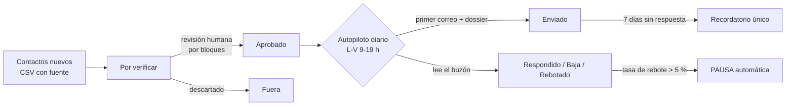

# Agente de captación por correo · caso real de QA


Agente en Python que capta clientes por correo electrónico para **ConFauna**, mi empresa de control de aves en Málaga. Está **en producción desde el 29/10/2026**: envía cada día laborable, hace seguimiento y lee el buzón para detectar respuestas, bajas y rebotes.

Lo desarrollé con asistencia de IA (Claude). Mi papel fue el de **producto y QA**: definir los requisitos, diseñar los frenos de seguridad, probarlo, validarlo en producción y detectar y gestionar los defectos que aparecieron con datos reales.

> Este repositorio no contiene datos reales: ni contactos, ni credenciales, ni el dossier comercial. Los nombres y teléfonos de ejemplo son ficticios.

## Resultados en producción (29/10 – 10/11/2026)

| Métrica | Valor |
|---|---|
| Correos enviados | 136 (100 primeros contactos y 36 recordatorios) |
| Tasa de rebote | 3 % (3 de 100), con el freno automático fijado en el 5 % |
| Respuestas | 3, todas de administradores de fincas; 2 llegaron tras el recordatorio |
| Bajas | 0 |
| Pruebas automáticas | 42, todas en verde |

## Cómo funciona



- **Segmentos** con plantilla propia: administradores de fincas, hoteles, ayuntamientos, instaladoras fotovoltaicas y agroindustria.
- **Solo librería estándar** de Python. Envío por SMTP con OAuth 2.0 (Google Workspace) y lectura por IMAP.

## Estrategia de calidad

| Riesgo | Control | Cómo se prueba |
|---|---|---|
| Escribir a quien no debe | Puerta de verificación humana: nada sale sin aprobar | `TestVerificacion` |
| Dañar la reputación del dominio | Calentamiento (5 correos el primer día, +2 al día hasta 20), pausas aleatorias entre envíos, solo L-V de 9 a 19 h | `TestAutopiloto` |
| Listas sucias | Freno automático si rebota más del 5 % (con 20 o más enviados) | `test_freno_por_tasa_de_rebote`, `test_con_pocos_enviados_no_se_frena` |
| Duplicados tras un fallo | Los lotes interrumpidos se reanudan sin repetir envíos | `test_error_a_mitad_se_reanuda_sin_duplicar` |
| Seguir escribiendo a quien contesta | Lectura del buzón en cada pase; respuestas y bajas cortan la secuencia | `TestBuzon` |
| Cumplimiento (LSSI/RGPD) | Remitente identificado, origen público del dato y baja en un clic en cada plantilla | `test_las_cuatro_plantillas_renderizan_sin_huecos` |

Las pruebas no salen a internet: SMTP, IMAP y OAuth se sustituyen por dobles de prueba, y el inicio de sesión XOAUTH2 se prueba contra un servidor SMTP mínimo levantado en local. Además, el modo sin `--real` simula todo el envío y muestra qué haría.

## Defectos encontrados en producción

| ID | Defecto | Severidad | Causa raíz | Corrección | Regresión |
|---|---|---|---|---|---|
| BUG-01 | Un despacho contestó "lo tendremos en cuenta" y el agente lo marcó como **baja** | Media | Se buscaba la palabra "baja" en todo el cuerpo, y el pie legal del despacho decía "mándenos un e-mail con la palabra baja" | Solo se analizan el asunto y las primeras líneas de la respuesta; se corta en firmas y pies legales | `test_pie_legal_con_la_palabra_baja_no_es_una_baja`, `test_baja_al_principio_aunque_haya_pie_legal` |
| BUG-02 | El recordatorio decía "las comunidades que gestiona" y lo iban a recibir hoteles y ayuntamientos | Baja (detectado antes de enviarse) | Plantilla escrita pensando en un solo segmento | Texto válido para cualquier segmento | Render de todas las plantillas |
| INC-03 | 3 rebotes en 100 envíos | Media | Correos de dominios secundarios o de directorios desactualizados | Nueva regla de datos: solo correos visibles en la web propia del contacto y del mismo dominio | Verificación por bloques con aviso de dominios personales |
| INC-04 | Bloqueos por política del servidor (`550 5.7.1`) contaban igual que direcciones inexistentes (`550 5.1.1`) | Media | El freno no distinguía tipos de rebote | Reclasificación manual como "descartado" | Pendiente de automatizar |
| KNOWN-05 | Las pruebas fallan si se ejecutan en una carpeta con un `.env` real | Baja | Falta de aislamiento: la configuración local se mezcla con la de las pruebas | Pendiente: aislar la carga del `.env` en las pruebas | En CI pasan, porque allí no hay `.env` |

## Ejecutar las pruebas

```bash
python -m unittest discover -s tests -v
```

Se necesita Python 3.10 o superior y nada más. GitHub Actions las ejecuta en cada *push* (`.github/workflows/tests.yml`).

## Uso

```bash
python agente.py importar data/ejemplo_importar.csv --por-verificar
python agente.py verificar
python agente.py autopiloto          # simulación
python agente.py autopiloto --real   # envío real (requiere .env y autorización)
```

Configuración: copia `.env.example` como `.env`. Para Google Workspace, sigue `GUIA_GOOGLE_OAUTH.md`. El dossier que se adjunta va en `dossier/` y no se incluye aquí.
